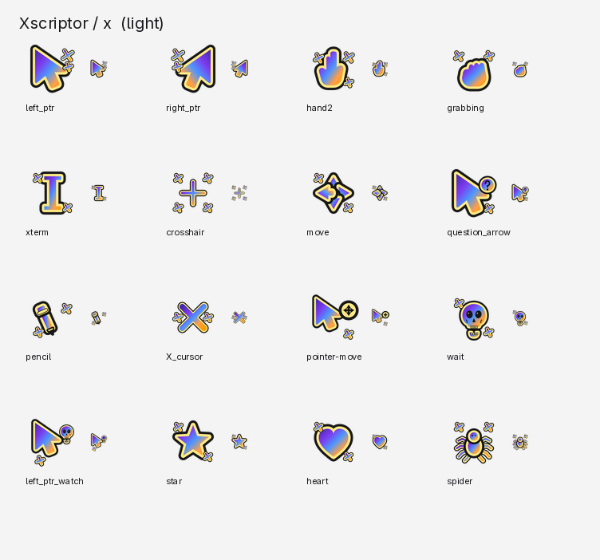
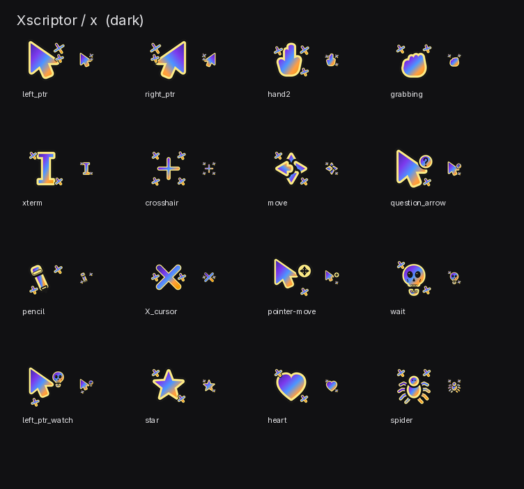
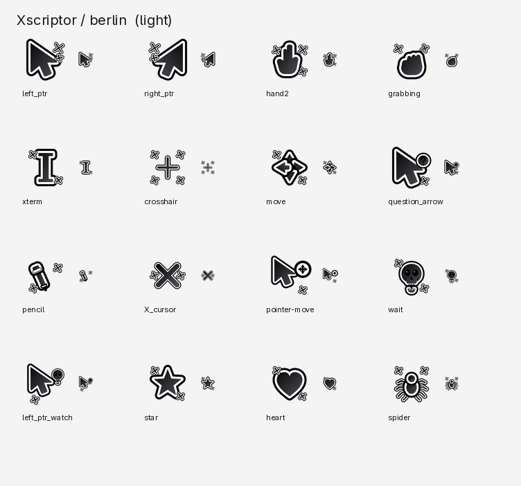
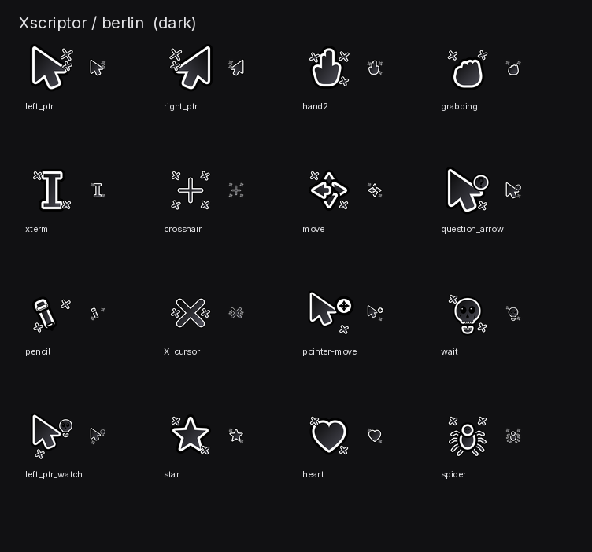

<h1 align="center">Cursors</h1>

<p align="center">
  Original X11/Xcursor themes for Linux, drawn from scratch in the Xscriptor palette:
  a gradient body, a bright rim, a dark contour and small X marks around every glyph.
</p>

<p align="center">
  
  
  
  
  
  
  
  
</p>

<hr />

## Preview

### Xscriptor-X

<p align="center">
  
  
</p>

### Xscriptor-Berlin

<p align="center">
  
  
</p>

## Packs

| Pack | Look | Notes |
|------|------|-------|
| **Xscriptor-X** | Violet → blue → orange gradient, gold rim, dark contour, X sparks | Full-colour pack |
| **Xscriptor-Berlin** | Monochrome, white rim, dark contour, X sparks | Works on light and dark desktops |

Both packs share the same geometry and hotspots. The only animated cursors are
`wait` and `left_ptr_watch`: a skull that opens and closes its jaw, 12 frames at
70 ms per frame.

## Coverage

- **179 entries per pack**: 78 cursors + 101 standard aliases.
- **10 nominal sizes**: 16, 20, 22, 24, 28, 32, 40, 48, 64 and 96 px.
- Every name shipped by modern system themes (Bibata, Adwaita, Breeze, KDE) is present.
- Every glyph in `X11/cursorfont.h` is present.
- No broken symlinks, no clipped frames and no out-of-bounds hotspots
  (`make validate` checks this).

## Palette

| Token | Value |
|-------|-------|
| X gradient | `#4328a8` → `#7c3aed` → `#4d96ff` → `#ff9f43` → `#f59e0b` |
| X rim | `#ffe884` |
| X contour | `#171717` |
| Berlin gradient | `#0a0a0a` → `#4b4b55` |
| Berlin rim | `#ffffff` |
| Berlin contour | `#000000` |

## Install

### Quick install

```bash
git clone https://github.com/xscriptor-colors/cursors.git
cd cursors
make install
```

The themes are copied to `~/.local/share/icons/Xscriptor-X` and
`~/.local/share/icons/Xscriptor-Berlin`.

### Hyprland / Wayland

Apply immediately:

```bash
hyprctl setcursor Xscriptor-X 24
# or:
hyprctl setcursor Xscriptor-Berlin 24
```

Make it permanent. In `~/.config/hypr/env.lua`:

```lua
hl.env("XCURSOR_THEME", "Xscriptor-X")
hl.env("XCURSOR_SIZE", "24")
```

Also update the cursor autostart (or `gsettings` will bring the old theme back
next login):

```lua
hl.exec_cmd("hyprctl setcursor Xscriptor-X 24")
hl.exec_cmd("gsettings set org.gnome.desktop.interface cursor-theme 'Xscriptor-X'")
hl.exec_cmd("gsettings set org.gnome.desktop.interface cursor-size 24")
```

### GTK apps

If a GTK app still uses another cursor, set it in both files:

```ini
# ~/.config/gtk-3.0/settings.ini
# ~/.config/gtk-4.0/settings.ini
gtk-cursor-theme-name=Xscriptor-X
gtk-cursor-theme-size=24
```

### Manual install

```bash
cp -r build/themes/Xscriptor-X ~/.local/share/icons/
cp -r build/themes/Xscriptor-Berlin ~/.local/share/icons/
```

## Build

Requirements:

- Python 3.10+
- [`clickgen`](https://github.com/ful1e5/clickgen) (provides `ctgen`)
- Pillow
- `librsvg` (provides `rsvg-convert`)

```bash
pip install -r scripts/requirements.txt
make            # generate + build + validate + preview
make install    # build and copy both themes to ~/.local/share/icons
make validate   # coverage, Xcursor format and hotspot checks
make preview    # full contact sheets in preview/ and docs/
make clean      # remove build/ and preview/
```

The generated binaries are not committed. The SVG sources in `src/` are the
single source of truth; `build/themes` is reproducible from them.

## Repository layout

```
scripts/     artwork, catalogue, generators and validation
src/x/       Xscriptor-X SVG sources (generated, committed)
src/berlin/  Xscriptor-Berlin SVG sources (generated, committed)
docs/        preview images used by this README
build/       generated PNGs, manifests and Xcursor themes (ignored)
preview/     full contact sheets (ignored)
Makefile     local pipeline
```

## Scripts

| File | Purpose |
|------|---------|
| `scripts/art.py` | Original SVG artwork and palette definitions |
| `scripts/spec.py` | Cursor catalogue: hotspot, PNG pattern and X11 aliases |
| `scripts/generate.py` | Writes the SVG sources in `src/` |
| `scripts/build.py` | SVG → PNG → clickgen manifest → `ctgen` |
| `scripts/preview.py` | Contact sheets and README previews |
| `scripts/validate.py` | Coverage, Xcursor format, hotspots and animation checks |

## Design notes

- Every glyph is original; no Bibata assets or traced artwork are used.
- Cursor **slot names** are part of the X11/Xcursor conventions and are not claimed.
- The `X` marks are decorative, long enough to read as an X at 24 px.
- The dark contour keeps the cursor visible on light backgrounds; the gold/white
  rim keeps it visible on dark ones.
- Hotspots are defined once on the 256×256 canvas and scaled by `clickgen`.

## License

- **Code** (`scripts/`, `Makefile`): MIT. See [LICENSE](LICENSE).
- **Artwork** (`src/`, generated cursors, `docs/` previews): CC BY 4.0.
  See [LICENSE-ART](LICENSE-ART).
- **Trademarks**: see [TRADEMARKS.md](TRADEMARKS.md).

## Related repositories

- [xscriptor-colors](https://github.com/xscriptor-colors) — themes for terminals, editors and desktops.
